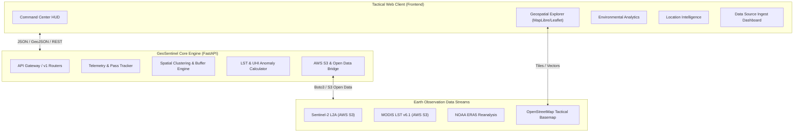

# GeoSentinel 🛰️ 🌍
> **Planetary Intelligence & Earth Observation Platform**

GeoSentinel is a cloud-native, tactical geospatial intelligence platform designed for high-resolution environmental monitoring, urban heat island analysis, satellite raster telemetry, and location intelligence. Engineered with high-contrast tactical HUD aesthetics, real-time telemetry indexing, and seamless integration with AWS Earth Observation Open Data registries.

---

## 🌟 Key Features

* **🛰️ Orbital Synchronization & Telemetry HUD**: Real-time pass tracking for Sentinel-2C, Landsat-9, and MODIS Aqua/Terra with Zulu time synchronization and ingest pipeline telemetry.
* **🗺️ Tactical Geospatial Explorer**: High-performance interactive cartographic engine with vector graticules, AOI (Area of Interest) bounding polygon indexing, thermal anomaly radiance detection, and multi-spectral raster overlay stacks.
* **🌡️ Environmental Analytics & Urban Heat Island (UHI)**: Multi-temporal land surface temperature (LST) anomaly indexing, 10-year ERA5 baseline comparisons, NDVI canopy degradation metrics, and zonal risk statistics.
* **📍 Location Intelligence & Spatial Buffers**: Density clustering algorithms, vulnerable infrastructure scoring, multi-radius buffer computations (1 km, 5 km, 10 km), and automated GeoJSON intelligence reporting.
* **☁️ AWS Open Data Ingestion Engine**: Zero-configuration anonymous or authenticated access to public S3 Earth Observation buckets (`s3://sentinel-s2-l2a`, `s3://modis-pds`, `s3://noaa-hrrr-bdp-pds`).
* **⚡ High-Performance FastAPI Backend**: OpenAPI / Swagger documented RESTful API endpoints for spatial analytics, telemetry metrics, and GeoJSON feature collections.
* **🐳 Fully Containerized & Reproducible**: Docker and Docker Compose definitions for one-command local and production deployments.

---

## 📐 System Architecture



---

## 🚀 Quick Start Guide

### Prerequisites
* **Python 3.10+**
* **Node.js 18+** (for frontend development) or modern web browser
* **Docker & Docker Compose** (optional, for containerized run)

### 1. Clone the Repository
```bash
git clone https://github.com/ASingha165/GeoSentinel.git
cd GeoSentinel
```

### 2. Environment Configuration
Copy the sample environment configuration file:
```bash
cp .env.example .env
```
*(AWS credentials are optional. GeoSentinel runs with public anonymous access to Earth Observation data out of the box).*

### 3. Running with Python / FastAPI Backend
```bash
# Create virtual environment
python -m venv .venv
# Activate virtual environment (Windows)
.venv\Scripts\activate
# (Linux/macOS)
source .venv/bin/activate

# Install dependencies
pip install -r backend/requirements.txt

# Start GeoSentinel API Server
uvicorn backend.app.main:app --host 0.0.0.0 --port 8000 --reload
```

Interactive API documentation will be available at:
* Swagger UI: [http://localhost:8000/docs](http://localhost:8000/docs)
* Redoc: [http://localhost:8000/redoc](http://localhost:8000/redoc)

### 4. Running the Frontend
The tactical web application is served directly by the FastAPI backend at `http://localhost:8000`, or can be run independently using any static web server:
```bash
# Using Python built-in server for frontend
python -m http.server 3000 --directory frontend
```

### 5. Running with Docker Compose
```bash
docker compose up --build
```
Access the application at [http://localhost:8000](http://localhost:8000).

---

## 🗂️ Project Directory Structure

```text
GeoSentinel/
├── .github/
│   └── workflows/
│       └── ci.yml                     # Automated CI/CD workflow
├── backend/
│   ├── app/
│   │   ├── api/
│   │   │   ├── telemetry.py           # Real-time satellite & HUD telemetry
│   │   │   ├── layers.py              # Geospatial raster/vector layers & GeoJSON
│   │   │   ├── environmental.py       # Urban Heat Island & LST anomaly analysis
│   │   │   ├── location.py            # Spatial clustering & buffer analysis
│   │   │   └── aws_data.py            # AWS Open Data Registry S3 connector
│   │   ├── aws/
│   │   │   ├── s3_client.py           # S3 client with anonymous fallback
│   │   │   └── registry.py            # Earth Observation dataset catalog
│   │   ├── core/
│   │   │   └── config.py              # Pydantic environment configuration
│   │   ├── datasets/
│   │   │   └── sample_aoi.py          # Seed GeoJSON datasets (Phoenix, etc.)
│   │   └── main.py                    # FastAPI application entrypoint
│   └── requirements.txt               # Backend dependencies
├── frontend/
│   ├── index.html                     # Unified Tactical HUD Application
│   ├── css/
│   │   └── tactical.css               # Tactical color tokens & animations
│   ├── js/
│   │   ├── app.js                     # State management, router & views
│   │   ├── map.js                     # Leaflet / MapLibre cartography engine
│   │   ├── telemetry.js               # HUD clock & live telemetry streams
│   │   └── api.js                     # Asynchronous backend API client
│   └── assets/                        # Design assets, icons & presets
├── stitch_geosentinel_intelligence_platform/ # Original design specs & HUD prototypes
├── tests/
│   ├── test_telemetry.py              # Telemetry & Zulu clock tests
│   ├── test_layers.py                 # GeoJSON schema validation tests
│   ├── test_environmental.py          # LST anomaly & UHI calculations tests
│   └── test_aws_data.py               # AWS S3 Open Data reader tests
├── docker/
│   ├── Dockerfile                     # Multi-stage production container
│   └── docker-compose.yml             # Orchestration configuration
├── .env.example                       # Sample environment configuration
├── .gitignore                         # Git security & exclusion rules
└── README.md                          # Project documentation
```

---

## 🔒 Security & Privacy

* **Strict Credential Isolation**: GeoSentinel strictly prevents credential leakage. Keys and `.env` files are ignored by git.
* **Anonymous S3 Access**: Public Earth Observation datasets on AWS are queried via unsigned requests, removing the requirement to store or expose cloud credentials.
* **CORS & Input Validation**: All spatial requests, coordinates, and polygon payloads are strictly validated using Pydantic schemas.

---

## 📜 License

Licensed under the [Apache 2.0 License](LICENSE).
