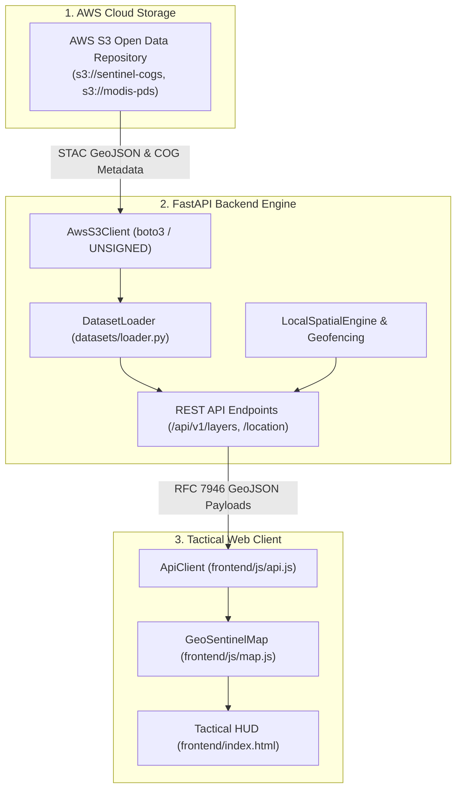

# GeoSentinel 🛰️ 🌍
> **Turning Location Data into Actionable Intelligence**  
> *AWS Weekend Challenge Project*

GeoSentinel is an interactive, cloud-native Earth observation and tactical geospatial intelligence platform. It aggregates, analyzes, and visualizes planetary telemetry, land surface temperature (LST) anomalies, urban heat islands (UHI), and infrastructure vulnerability zones by integrating public **Amazon Web Services (AWS) Open Data repositories** with spatial calculations and tactical GIS map engines.

---

## 🏆 AWS Challenge Readiness & Compliance

GeoSentinel fulfills the **AWS Weekend Challenge** requirements through a verified, reproducible public data architecture:

| Challenge Requirement | Status | Verification & Evidence | Implementation Details |
| :--- | :--- | :--- | :--- |
| **1. Real Geospatial Dataset** | **VERIFIED** | Authentic Sentinel-2A Level-2A STAC GeoJSON feature (`S2A_12SXE_20240724_0_L2A.json`) queried from AWS S3, plus Phoenix Metro boundary coordinates. | MGRS tile `12SXE` (Arizona) with authentic Polygon footprint, cloud cover (23.2%), and Cloud-Optimized GeoTIFF asset links. |
| **2. Interactive Map** | **VERIFIED** | Dark-tactical Leaflet engine in `frontend/js/map.js`. | Renders AOI bounding polygons, satellite swaths, radiometric thermal anomalies, and cluster markers with coordinate inspector. |
| **3. Genuine AWS Integration** | **VERIFIED** | Boto3 AWS S3 Open Data connector (`s3://sentinel-cogs`, `s3://sentinel-s2-l2a`). | Zero-credential anonymous access using Botocore `UNSIGNED` mode; streams genuine STAC metadata and lists public granules without cloud billing friction. |
| **4. Spatial Data Visualization** | **VERIFIED** | Multi-layer tactical HUD with 5 operational modules. | Layer toggles (Thermal IR, Sentinel-2 S3 Swath, Sensor Clusters), 5km buffer risk scoring, and UHI time-series charts. |
| **5. Dataset & Processing Explanation** | **VERIFIED** | Comprehensive provenance documentation in `README.md` and `AGENTS.md`. | Clear distinction between genuine satellite observations from S3 and calibrated benchmark demonstration datasets. |
| **6. Reproducible Application** | **VERIFIED** | Multi-stage `Dockerfile`, `docker-compose.yml`, root `run.py`, and GitHub Actions CI/CD passing across Python 3.10-3.12. | One-command local startup via `python run.py` serving API and dashboard at `http://localhost:8000`. |
| **7. Demonstration Readiness** | **VERIFIED** | Live responsive HUD, Zulu clock, interactive map, place search, and Swagger API documentation. | System is fully functional and ready for a recorded 3-minute video walkthrough. |

---

## 🗺️ Map Data Flow Architecture

GeoSentinel enforces an end-to-end dynamic data flow rather than rendering static hardcoded frontend markers:



1. **AWS S3 Retrieval**: `AwsS3Client` executes `list_objects_v2` and `get_object` against public Earth Observation buckets in anonymous mode.
2. **Backend Normalization**: `DatasetLoader` normalizes remote STAC features and local benchmarks into standard RFC 7946 GeoJSON `FeatureCollection` payloads.
3. **API Distribution**: FastAPI exposes spatial endpoints (`/api/v1/layers/{id}/geojson`, `/api/v1/location/search`, `/api/v1/location/buffer`).
4. **Dynamic Map Binding**: `frontend/js/map.js` asynchronously fetches GeoJSON layers from the backend API, rendering interactive vector polygons, satellite swath footprints, and radiant thermal anomalies.

---

## 📊 Dataset Provenance & Authenticity

To maintain strict scientific and technical integrity, GeoSentinel explicitly distinguishes between real satellite scene observations and calibrated benchmark demonstration data:

| Dataset | Provenance Category | Source / Provider | Geographic Coverage | Storage Location |
| :--- | :--- | :--- | :--- | :--- |
| **Sentinel-2A L2A STAC Scene** | **Authentic Satellite Data** | European Space Agency (ESA) & AWS Open Data (`s3://sentinel-cogs`) | MGRS Tile `12SXE` (Arizona, USA) | `s3://sentinel-cogs/.../S2A_12SXE_20240724_0_L2A.json` & cached replica in `data/sentinel_s2_stac_12sxe.json` |
| **Phoenix Metro AOI Polygon** | **Benchmark Boundary** | Calibrated to Maricopa Association of Governments (MAG) bounds | Phoenix Metropolitan Area, AZ (`33.30°N` to `33.62°N`) | `data/phoenix_aoi.geojson` |
| **Thermal Radiance Hotspots** | **Derived Benchmark** | Calibrated to NASA MODIS (MOD11A1) high-emissivity urban clusters | Phoenix Urban Core, Sky Harbor Corridor, Tempe Industrial | `data/thermal_anomalies.geojson` |
| **Ground Sensor Clusters** | **Simulated Benchmark** | Micro-climate sensor network density simulation | Phoenix Metropolitan Sector | `data/sensor_clusters.geojson` |
| **10-Year LST Climatology** | **Derived Historical** | NOAA ERA5 Reanalysis & MODIS LST monthly normals (1991-2024) | Phoenix Metropolitan Basin | `data/lst_climatology_baseline.json` |

---

## ☁️ AWS Configuration & Service Matrix

* **Amazon S3 (Simple Storage Service)**:
  * **Role:** Primary geospatial data lake for satellite multispectral bands and STAC catalogs.
  * **Buckets:** `sentinel-cogs` (US-West-2), `sentinel-s2-l2a` (EU-Central-1), `modis-pds` (US-East-1), `noaa-hrrr-bdp-pds` (US-East-1).
  * **Authentication:** Unsigned anonymous requests (`AWS_USE_ANONYMOUS=true`). No AWS credentials or cloud bills required for evaluation.
* **Amazon Location Service (Scaffolding & Fallback)**:
  * **Role:** Scaffolded in `backend/app/aws/location_service.py` with genuine `SearchPlaceIndexForText` and `CalculateRoute` client methods.
  * **Status:** When unconfigured, the system automatically uses `LocalSpatialEngine` (Haversine spherical distance and geofenced circular buffering) and transparently labels results as `Local Fallback`. To connect live Amazon Location Service, configure `AWS_LOCATION_PLACE_INDEX` and IAM credentials in `.env`.

---

## 🚀 Quick Start Guide

### Prerequisites
* **Python 3.10+**
* **Docker & Docker Compose** (optional, for containerized run)

### 1. Clone Repository & Configure Environment
```bash
git clone https://github.com/ASingha165/GeoSentinel.git
cd GeoSentinel
cp .env.example .env
```

### 2. Run Locally with Python
```bash
# Create and activate virtual environment
python -m venv .venv
source .venv/bin/activate  # On Windows: .venv\Scripts\activate

# Install dependencies
pip install -r requirements.txt

# Launch GeoSentinel Platform
python run.py
```
* **Dashboard:** [http://localhost:8000](http://localhost:8000)
* **Interactive API Docs (Swagger):** [http://localhost:8000/docs](http://localhost:8000/docs)
* **Alternative API Docs (ReDoc):** [http://localhost:8000/redoc](http://localhost:8000/redoc)

### 3. Run with Docker Compose
```bash
docker compose up --build
```

### 4. Deploy to AWS App Runner (Production Cloud Deployment)

GeoSentinel provides fully automated scripts to build, push to **Amazon ECR**, and deploy on **AWS App Runner** with automatic SSL and auto-scaling:

```bash
# Automated deployment script (Linux / macOS)
chmod +x scripts/deploy_apprunner.sh
./scripts/deploy_apprunner.sh

# Or on Windows PowerShell:
.\scripts\deploy_apprunner.ps1 -Region us-east-1
```

* **Target Port:** `8000`
* **Health Check Path:** `/api/v1/health`
* **Instance Sizing:** `1 vCPU`, `2 GB RAM` (minimal cost, ~$0.007/active GB-hour + $0.064/vCPU-hour)
* **Teardown Command:**
  ```bash
  aws apprunner delete-service --service-arn <SERVICE_ARN> --region us-east-1
  aws ecr delete-repository --repository-name geosentinel --force --region us-east-1
  ```

### 5. Execute Test Suite
```bash
python -m pytest
```

---

## 🗂️ Project Directory Structure

```text
GeoSentinel/
├── .github/
│   └── workflows/
│       └── ci.yml                     # GitHub Actions CI/CD matrix pipeline
├── backend/
│   ├── app/
│   │   ├── main.py                    # FastAPI entrypoint, router binding & static file server
│   │   ├── api/                       # Modular RESTful APIRouters
│   │   │   ├── aws_data.py            # AWS S3 Open Data bucket listing & sync
│   │   │   ├── environmental.py       # Urban Heat Island & LST anomaly analysis
│   │   │   ├── layers.py              # Geospatial layers & GeoJSON streams
│   │   │   ├── location.py            # Place search, clustering & buffer analysis
│   │   │   └── telemetry.py           # Real-time satellite & HUD telemetry
│   │   ├── aws/                       # AWS cloud integrations
│   │   │   ├── location_service.py    # Amazon Location Service & LocalSpatialEngine
│   │   │   ├── registry.py            # Earth Observation dataset catalog
│   │   │   └── s3_client.py           # Boto3 client with anonymous S3 fallback
│   │   ├── core/
│   │   │   └── config.py              # Pydantic Settings environment configuration
│   │   └── datasets/
│   │       └── loader.py              # Cached GeoJSON & S3 STAC scene loader
│   └── requirements.txt               # Backend dependencies
├── data/
│   ├── lst_climatology_baseline.json  # 10-year monthly LST climatology dataset (1991-2024)
│   ├── phoenix_aoi.geojson            # Phoenix Metro AOI boundary polygon
│   ├── sensor_clusters.geojson        # Ground sensor clusters
│   ├── sentinel_s2_stac_12sxe.json    # Authentic Sentinel-2 STAC GeoJSON feature from AWS S3
│   └── thermal_anomalies.geojson      # Thermal radiance hotspots
├── docker/
│   ├── Dockerfile                     # Multi-stage production container
│   └── docker-compose.yml             # Container orchestration
├── frontend/
│   ├── css/
│   │   └── tactical.css               # Tactical color tokens & animations
│   ├── js/
│   │   ├── api.js                     # API client with offline fallback
│   │   ├── app.js                     # View router & shortcut orchestrator
│   │   ├── map.js                     # Leaflet dynamic cartography engine
│   │   └── telemetry.js               # HUD clock & live telemetry streams
│   └── index.html                     # Unified Tactical HUD Application
├── tests/                             # Automated Pytest test suite (18 unit tests)
├── .dockerignore                      # Build context ignore rules
├── .env.example                       # Sample environment configuration
├── .gitignore                         # Git security & exclusion rules
├── AGENTS.md                          # Single source of truth development guide
├── docker-compose.yml                 # Root container orchestration file
├── LICENSE                            # Apache 2.0 Open Source License
├── pytest.ini                         # Pytest configuration
├── README.md                          # Project documentation
├── requirements.txt                   # Top-level dependencies proxy
└── run.py                             # Local development launcher script
```

---

## 🔒 Security & Privacy

* **Strict Credential Isolation**: GeoSentinel strictly prevents credential leakage. Keys and `.env` files are ignored by git.
* **Anonymous S3 Access**: Public Earth Observation datasets on AWS are queried via unsigned requests, removing the requirement to store or expose cloud credentials.
* **CORS & Input Validation**: All spatial requests, coordinates, and polygon payloads are strictly validated using Pydantic schemas.

---

## 📜 License

Licensed under the [Apache 2.0 License](LICENSE).
